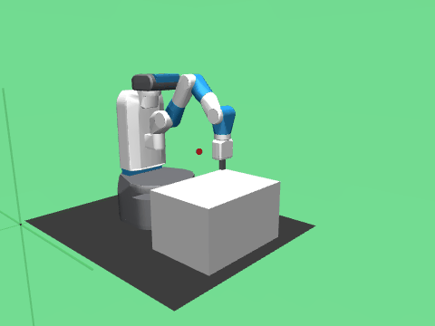
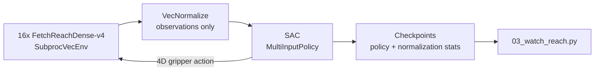

# robotic-arm-reinforcement-learning

I taught a simulated robot arm to reach for a target by trial and error, with no hand-written kinematics. It's a Fetch arm in MuJoCo, trained with Soft Actor-Critic.



The trained policy on six random targets. The red dot is the target.

## The problem

Getting an arm's gripper to a target is normally solved with inverse kinematics written by hand for that specific arm. I wanted to see how far a learned policy gets with no kinematic model at all, only trial, error and a distance signal, and to be able to watch it improve.

## What I built

A small training and replay pipeline around `FetchReachDense-v4` from Gymnasium-Robotics.

| Script | What it does |
|---|---|
| `01_watch_random.py` | The arm under a random policy, as a baseline for what "untrained" looks like |
| `02_train_reach.py` | Trains SAC for 500k steps on 16 parallel environments and saves checkpoints |
| `03_watch_reach.py` | Replays one episode per checkpoint in order, so you watch the policy go from flailing to reaching |

## Result

The trained policy in this repo (`sac_fetch_reach_final.zip`, 500k steps) reaches the target in 100 out of 100 evaluation episodes with deterministic actions. Mean final distance to the target is 1.7 cm against a success threshold of 5 cm, and the gripper is inside the threshold after a median of 5 control steps.

## Architecture



The observation is a dict (robot state, achieved goal, desired goal), which is why the policy is `MultiInputPolicy`. The action is a 4D gripper displacement, and the simulator resolves it to joint motion.

## Design decisions

- SAC, because it is off-policy and sample efficient on continuous control, and its entropy term handles exploration without a hand-tuned noise schedule.
- The dense reward (negative distance to the target) instead of the sparse one. Sparse reward needs hindsight replay to learn at all. Dense is the simpler baseline to get working first.
- Observations are normalized with running statistics, rewards are not. The reward is already a distance in meters, and keeping it raw keeps the training curves readable.
- Every checkpoint saves the normalization statistics next to the policy. A policy replayed with different statistics sees inputs on a different scale and behaves like an untrained one.
- Checkpoints are spaced roughly logarithmically (2k, 5k, 10k, 20k, and on up to 400k). Most of the visible learning happens early, so that is where the replay needs resolution.
- 16 environments in subprocesses on CPU. The networks are small, so the physics simulation is the bottleneck, not the gradient step.

## Setup

```bash
python3 -m venv .venv && .venv/bin/pip install -r requirements.txt
```

`requirements.txt` pins `mujoco<3.12`. Newer MuJoCo releases fail an assertion inside the Fetch environments of gymnasium-robotics 1.4.

## Run

Watch the trained policy (works on a fresh clone, it falls back to the shipped final policy when there are no checkpoints):

```bash
.venv/bin/python 03_watch_reach.py
```

Train from scratch, which writes `checkpoints/` and TensorBoard logs to `tb_logs/`:

```bash
.venv/bin/python 02_train_reach.py
```

```bash
.venv/bin/tensorboard --logdir tb_logs
```

Then run `03_watch_reach.py` again to replay every checkpoint in order.

## Next

- Sparse reward with hindsight experience replay
- `FetchPickAndPlace`, where the arm has to grasp before it moves
